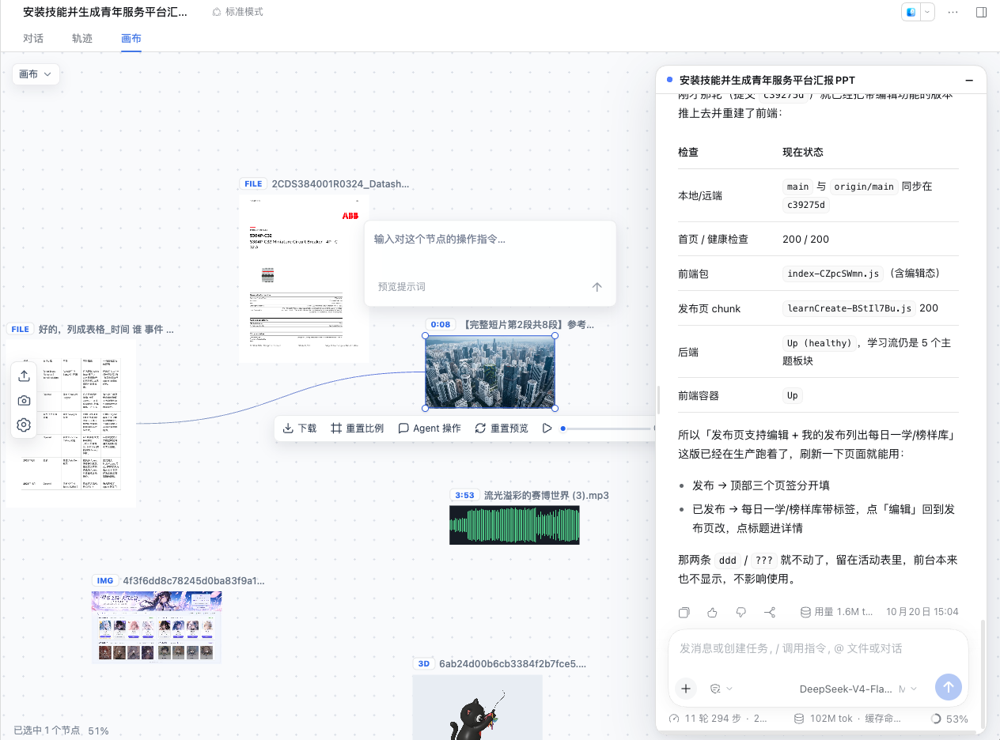
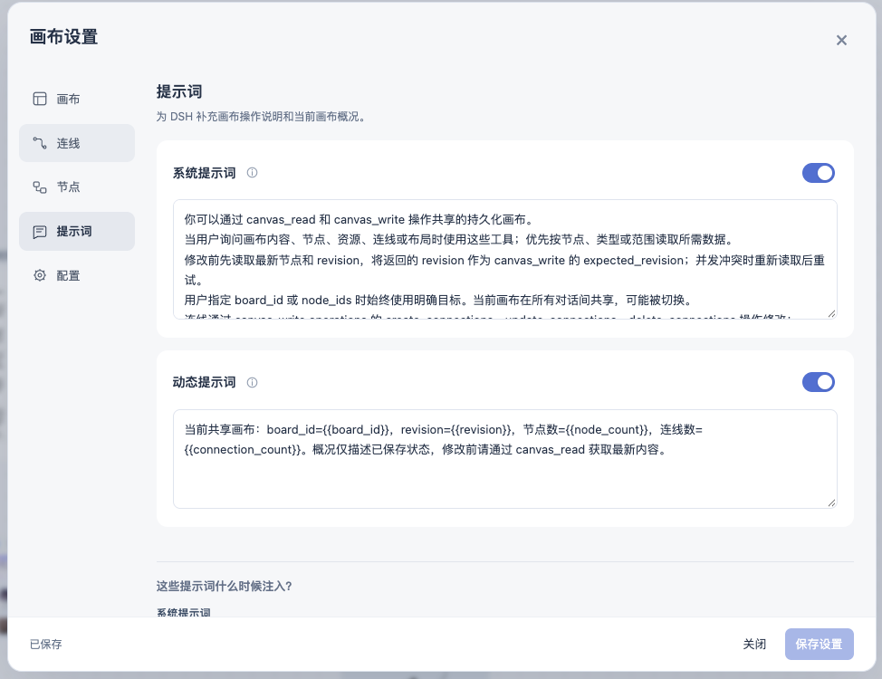

# DSH Client Canvas

[](LICENSE)

**AI 原生多模态画布，让素材、想法与 Agent 在同一个空间里协作。**

把图片、视频、音频、3D 模型、PDF、文档与代码放进一块可持续编辑的画布，用节点与连线组织上下文，在查看素材的同时直接向 Agent 发出操作指令。从资料收集、内容创作到结果整理，让对话与成果在画布上连接起来。

*An AI-native multimodal canvas for DeepSeek Harness — bring media, files, and agent collaboration into one persistent visual workspace.*

[](https://github.com/deepseek-ai/deepseek-harness)
[](#多模态工作空间)
[](#快速开始)

## 多模态工作空间

- **素材集中展示**：图片直接查看，视频与音频可播放；3D 模型、PDF、Office、HTML、Markdown、文本与代码等文件生成预览，其他格式保留原文件卡片与下载入口。Office 预览需宿主提供转换服务。
- **可视化组织上下文**：多个画布、自由布局、缩放、选区与有向连线，把参考素材、过程节点和输出成果串成可浏览的关系图。
- **面向节点与 Agent 协作**：选中素材即可发送「Agent 操作」，按需携带当前节点、来源、后续或相连节点的上下文；在画布旁继续使用 DSH 原生对话。
- **Agent 直接读写画布**：通过 `canvas_read` 与 `canvas_write` 查询内容、创建与更新节点、调整布局及管理连线，生成结果可导入画布并保留节点关系。
- **持续保存与个性化配置**：文档与资源保存在本机，用户与 Agent 编辑同一份画布；可配置画布样式、节点参考范围、系统提示词与动态画布概况。

## 运行截图

### 素材、对话与创作成果同屏

图片、文件预览、视频、音频波形与 3D 模型节点集中在画布，右侧悬浮对话面板连接 Agent，选中节点即可继续发出指令。



### 让 Agent 理解你的画布

自定义系统提示词与动态画布概况，将当前画布、节点与连线信息作为协作上下文。



`@xindong/dsh-client-canvas` 为 [DeepSeek Harness](https://github.com/deepseek-ai/deepseek-harness) 提供浏览器画布，基于 [PixiBoardSDK](https://github.com/xindong/pixiboardSDK)，通过 [@xindong/dsh-canvas](https://github.com/xindong/dsh-canvas) 保存文档与资源。浏览器与 Agent 共用同一份画布数据。两个插件均以 MIT 许可证发布。

作者：[Kagari · @maoxinxin-xd](https://github.com/maoxinxin-xd)。

## 要求与安装

- Node.js **22.18+**、DSH **0.2.0-rc.2**；不支持旧版 DSH。Core 还使用 DSH 的 `tools` 和 `systemPrompt` 服务，Web 插件使用 Web Server 和 Conversation UI；Office 预览需要 DSH 的 `officeToPdf` 服务。
- 本包依赖已发布的 `pixiboardjs@0.1.0-alpha.5`。官方 site 源码快照固定在 SDK commit `4a22b10b4d902afc351b710da0002e0ed8117740`；这两个版本需保持匹配。

在已有 DSH 安装中，一条命令安装完整的画布 UI 与 Agent 工具：

```bash
dsh plugin --profile web add github:xindong/dsh-client-canvas
```

Web 包会从固定的 Core GitHub commit 传递安装 `@xindong/dsh-canvas`；其 bundle 补丁会先启用 Core，再启用 Web，无需单独安装 Core。启动 DSH：

```bash
dsh web
```

已有 DSH 进程需在安装或更新插件后重启，再刷新浏览器。打开 DSH 提供的完整登录地址（包括 `?token=...`），在会话中切换到 **Canvas** Tab。插件沿用当前 DSH 的数据目录（`$DSH_HOME`，默认 `~/.dsh`），不会自动迁移旧画布。

仅需要画布文档与 Agent 工具、不需要 Web UI 时，可单独安装 Core：`dsh plugin --profile web add github:xindong/dsh-canvas`。

**从旧版双插件安装迁移：**先停止 DSH，再依次运行：

```bash
dsh plugin --profile web add github:xindong/dsh-client-canvas
dsh plugin --profile web remove @xindong/dsh-canvas
```

第二条只移除 Core 的直接安装与独立 bundle 选择；Web 的依赖仍会提供 Core 代码。检查 `$DSH_HOME/profiles/web/package.json`（默认 `~/.dsh/profiles/web/package.json`）的 `dsh.profile.bundles`：只保留 `@xindong/dsh-client-canvas`，不要同时选择 `@xindong/dsh-canvas`。若另有手写 profile/home patch 插入 `xindong-canvas`，先迁移其中的自定义配置并移除重复条目。不要删除画布目录或 `canvas-storage.json`；确认无重复条目后再启动 DSH，刷新浏览器。

## 快速开始

在 Canvas Tab 中创建或选择画布，拖入图片、音视频或文件；可使用官方 site 的选区、缩放、右键菜单、重命名、下载、截图和播放等交互。画布 Tab 保留 DSH 侧栏与导航，右侧可拖动、调整宽度并折叠的悬浮对话面板复用原生会话输入；切回其他 Tab 时恢复原生布局。节点底部可下载或使用「Agent 操作」；删除在右键菜单中。

Agent 通过 Core 提供的 `canvas_read` 和 `canvas_write` 读写**同一份**全局画布：

```json
{"board_id":"board-id","node_ids":["source","result"],"limit":100}
```

```json
{"board_id":"board-id","expected_revision":12,"operations":[{"type":"create","nodes":[{"id":"result","type":"processing","x":400,"y":100,"props":{"title":"生成结果","status":"running"}}]}]}
```

`board_id` 可省略，此时使用当前画布；写入前读取 `revision`，发生冲突后重新读取再提交。`canvas_write` 支持创建、更新、原位转换、删除、布局与有向连线的创建/修改/删除，节点和连线修改在同一事务提交。`processing` 只是占位节点，**不会自行运行 AI 任务**；用已有 DSH 工具生成内容，再以 `asset_source` 导入或转换节点。文件来源可为本地路径或公网 HTTP(S) URL（单文件上限 64 MiB），详细参数见 [Core 文档](https://github.com/xindong/dsh-canvas#readme)。视口 `fit`、`center`、`zoom`、`pan`、`reset` 请求只作用于已打开的目标画布，不修改文档 revision。

选中节点后点「Agent 操作」，输入针对该节点的指令；Enter 发送、Shift+Enter 换行、Escape 关闭。发送前先保存画布，再将节点、关系和资源上下文送入当前 DSH 会话，不占用聊天草稿。发送失败保留指令；切换节点或会话不会继续发送旧指令。

## 数据与设置

- Core 是文档、revision、媒体二进制与 Agent 工具的唯一权威来源。默认画布位于 `$DSH_HOME/canvas`，资源位于其 `assets` 子目录；关系存放在文档 `metadata.connections`。保存经 revision 校验，Agent 修改会同步到 Web。
- 视口平移与缩放按画布保存在当前浏览器的 `sessionStorage`，刷新或切换 Tab 可恢复；它不属于共享文档。背景、网格、缩放限制与连线全局样式是浏览器偏好；网格仅供视觉参考，不参与吸附。连线选中后可用 Delete/Backspace 删除。
- 左侧齿轮中的画布、连线设置即时应用；节点与提示词设置保留草稿，点击「保存设置」后应用。节点工具栏入口、参考范围与上下文预算保存在当前浏览器；处理偏好和高级提示词保存在 DSH 的画布目录，供会话共用。共享设置保存失败时不提交浏览器草稿。
- 节点设置可选择只参考当前节点，或包含来源、后续、相连节点；处理偏好会随每次节点指令附带。提示词页可管理系统说明、动态概况并导入/导出 `{version: 1, agent, prompts}` 配置；「预览提示词」先保存画布、生成节点消息，但不调用模型。真正发送时重新采集上下文。
- 在设置的「配置」页填写已有目录的绝对路径或 `~/...` 路径；macOS 也可选择文件夹。目录指针存于 `$DSH_HOME/canvas-storage.json`，重启 DSH 后生效。切换只读取目标目录，**不迁移或删除原目录**。备份时同时保存画布目录和目录指针，迁移前停止 DSH 写入。

## 文件预览

导入 HTML/HTM、Markdown、文本/代码及 JSON/CSV/XML/YAML 等文件时先显示文件卡片，后台生成图片；PDF 默认渲染首页，Office 文件在可用的 `officeToPdf` 服务转换后走 PDF 通道。3D 模型由已发布的 `mivo-model-viewer@0.7.0/node` 预览，支持 GLB/GLTF、FBX、OBJ、STL、PLY、DAE、3MF、3DS、VRML/WRL、STEP/STP 和含模型的 ZIP。未知格式保留文件卡片及原文件，仍可下载或交给 Agent。

预览任务按类型有界调度，缓存源内容与规格对应的独立预览版本；首次缩略图长边默认 384px，选中时可请求更清晰的 detail（最长边 1024px），显式「重置预览」也请求 detail。后台结果通过 SSE 更新对应卡片，轮询用于断线恢复，不移动视口。拖动、缩放与网页刷新不会重新处理已有预览；失败保留原文件及已有图片，可从右键菜单重试。HTML 布局视口与画布节点尺寸分离，重置预览会保留布局宽度并按节点比例调整截图高度；PDF/Office 默认首页，长文档只显示有界的开头区域。

HTML 相对资源从同画布已导入资产的文件名或相对路径解析；单独导入 HTML 时缺失的资源不会自动补齐，补充资源后可刷新预览。HTML 文件夹/资源包 ZIP 的递归导入尚未接入，模型 ZIP 则单独识别。Office 排版受转换引擎和字体影响。插件依赖随安装提供；首次需要浏览器渲染时若缺少 Chromium，会自动安装（最多等待 5 分钟），安装失败可在插件目录运行 `node scripts/setup-preview-runtime.mjs` 手动准备后重试。预览性能与执行通道详见 [预览说明](docs/preview-performance.md)。

## 架构与安全边界

- `@xindong/dsh-canvas` 负责文档、资源、revision 和 Agent 工具；本插件负责 DSH `conversation.view` Tab、HTTP 桥接、预览任务与官方 site 的 DSH 适配。上游 site 保留画布交互和通用预览 UI，不另造画布实现。
- site 在同源 iframe 中运行，以隔离 CSS、DOM 和快捷键；**iframe 不是不可信代码的安全边界**。HTTP project/media adapter 将 site 的存储接回 Core，而不是使用浏览器 IndexedDB/OPFS 保存第二份画布。
- site 源码快照位于 `lib/site/upstream/`，Pixi 和图标浏览器模块位于 `lib/site/deps/`；Three.js 由锁定版本的 npm 包在本机提供，锁定信息见 `lib/site/upstream.json`。`lib/site-server.js` 在请求时对上游 TypeScript 做 Node 类型擦除并提供 ESM；SDK 浏览器运行时的 `pixiboardjs/browser`、`@pixi-board/core`、`@pixi-board/renderer-pixi` 和 `@pixi-board/adapter-browser` 全部通过 import map 指向**同一个**已发布 npm 浏览器 bundle `sdk/browser.js`，不加载本机 SDK 源码或另外编译一份 SDK。
- 预览请求在本地服务端处理。HTML 渲染页不带 DSH 登录 Cookie，禁止访问 `file:` 和内网/回环 API；“打开原始文件”使用带 CSP 沙箱的资产响应，而不是同源 Blob 页面。不要把外部文件内容当作可信指令。URL 导入仅允许公网 HTTP(S)，不跟随重定向。保护完整登录链接、会话凭据和画布数据，报告问题时先去除敏感信息。

## 上游更新与开发

在仓库根目录安装依赖后，重新导入当前锁定的 SDK site 快照：

```bash
node scripts/update-upstream.mjs
```

更新到指定提交前，先将项目依赖 `pixiboardjs` 调整为该提交的 SDK 包版本，然后导入并核对变更：

```bash
node scripts/update-upstream.mjs --revision <40-character-commit-sha>
```

也可用 `--latest` 明确跟进 SDK `main`，但其包版本仍须与依赖一致。脚本通过 `gh` 获取不可变源码快照，按上游 lockfile 获取并校验浏览器依赖；若 site 接入点或公开预览契约变化则中止，不应手工修改 `lib/site/upstream/`。更新后检查 `lib/site/upstream.json` 的 revision/version、适配层兼容性与许可证，再同步运行副本并重启 DSH。

本地开发可把 Core 与 Web 仓库放在同一父目录，将两份源码链接到 DSH 的 `web` profile，然后从 Web 仓库运行 `pnpm sync:runtime`（或 `bash scripts/sync-runtime.sh`）。开发 profile 的 `dsh.profile.bundles` 只选择 Web bundle，不能再选 Core bundle。`DSH_CANVAS_CORE_DIR` 可指定 Core 仓库，`DSH_WEB_PROFILE_DIR` 可指定 profile；修改服务端代码后重启 DSH，修改浏览器代码后刷新页面。`scripts/start-local.sh` 是仓库开发辅助入口，可同步两个插件并使用独立的 DSH 运行时；普通用户不需要它。

问题与贡献请使用 [GitHub Issues](https://github.com/xindong/dsh-client-canvas/issues)，提供版本、复现步骤与脱敏日志。许可证见 [LICENSE](LICENSE)；第三方依赖保留各自许可证。
