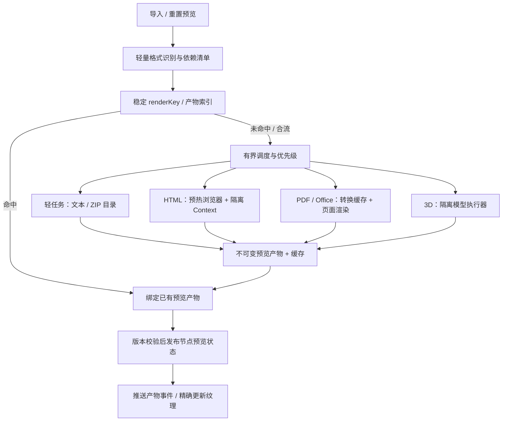

# 预览性能审计与架构建议

日期：2026-10-15。范围：DSH 画布、dsh-client-canvas 预览服务、mivo-model-viewer（初始调研基线 0.6.1，现已接入正式版 0.7.0）。本文的架构分析基于源码、现有缓存元数据与官方文档；未执行生产素材 benchmark、前端构建或类型检查。SDK 0.7.0 发布时额外通过了 7 项 Node 后端检查，包含简单 GLB 的连续真实渲染、准备缓存与 GPU 复用、取消/关闭和任务预算回收；这些检查不代表复杂素材的性能。耗时占比仍需结合实际预览日志评估。

## 结论

优先拆开预览调度、渲染产物和画布回显。先消除跨格式排队、重复准备和回显等待，再根据阶段计时决定是否改造 SDK 的常驻模型执行器。推荐本地内嵌队列和文件缓存起步；远程多用户部署再考虑 Redis/BullMQ 等基础设施。

## 实施状态

2026-10-15 已落地：阶段计时、分通道有界调度、最新请求替代、批量提交、SSE 精确回显、内容版本与缓存前置、模型实际依赖筛选、Office 中间缓存、缩略/高清档位、独立 Node PDF 渲染、隔离常驻模型 worker 与预算内 GPU 复用。预览产物按 `preview-<cacheKey>` 保存，节点分别引用自己的尺寸/清晰度；Core 与 SDK 校验同步支持这些有界引用。模型运行时已上游至 `mivo-model-viewer@0.7.0`，DSH 直接使用正式 SDK 的 `createModelPreviewProcessor()`，不再维护副本。

保留的边界：类型迁移使用原有安全文档同步兜底；HTML 缩略图仍需完成同样的 CSS 排版，降低的是图片输出与纹理成本；模型准备缓存复用的是准备后的 GLB，每个任务仍会构建/释放自己的 Three scene。未执行效果测试、benchmark、构建或类型检查，尚无本机提速倍数。`applyMs` 为补丁应用耗时，`textureReadyMs` 为事件收到到完成纹理解码的耗时，`frameMs` 为其后帧调度观测值，均不能证明像素已被用户看到。

下面的结构成本表记录改造前审计结果，不能当成改造后仍存在的问题清单。实施顺序保留作设计依据。

## 通用预览接入边界

DSH 前端通过 SDK `apps/site/src/preview.ts` 的 `configureSitePreviewHost` 注册任务与时序回调。初始化顺序固定为：加载 SDK preview 和 DSH `document-preview` → 配置 host → 导入上游 main → 等待启动完成 → 连接 store、Agent 与 SSE controller。

- SDK 负责通用 UI、状态标签、文件与 ZIP 分类、导入初始状态、预览规格和布局；core 提供 `createPreviewSpec`、`isDocumentPreviewType`、`isPreviewNodeType`、`previewStatusLabel` 与不可变预览引用校验。
- DSH 负责任务服务、请求 ID、board props、controller 批量提交、SSE 精确回显、纹理 epoch 和时序上报。`requestPreview` 直接进入 DSH 的 `requestDocumentPreview`，后者调用 core `createPreviewSpec(node, options)`，保留请求替代与提交路径。
- host 只提供 `requestPreview`、`getTextureEpoch`、`onTextureReady`；`classifyFile` 和 `importState` 使用 SDK 默认实现。DSH adapter 重导出 SDK 分类/状态函数，禁止将 SDK 包装函数再注册为它们自己的 host hook。
- 删除预览字符串补丁与 `preview-patches.js`；保留 DSH viewport/store/Agent seams。上游同步检查公开能力存在，核心 validator 不再依赖旧源码 anchor。SDK site 的 `fflate` 裸导入由 DSH import map 映射到已有浏览器依赖。

本次只修改接入层与同步校验脚本；未运行 sync、构建、类型检查、测试或重启。需要在包含新 API 的 SDK 快照同步后检查实际 seams；当前旧快照不具备这些接口。

## 已确认的结构成本

| 环节 | 源码事实 | 影响与边界 |
| --- | --- | --- |
| 调度 | `lib/preview-service.js` 的 FIFO 并发为 2，覆盖整个任务；`lib/model-preview.js` 将模型 processor 并发设为 1 | 两个模型任务可同时占住外层槽，其中一个仍在等待 SDK；HTML/PDF 随后排队。需要不同执行通道和总资源预算 |
| 缓存 | `run()` 先读原文件、计算哈希、收集模型资源，`sharedRender()` 才查磁盘缓存 | 磁盘命中仍支付准备成本；内存 job 去重可以更早返回，不能把两种命中混为一谈 |
| 配套资源 | 根据扩展名收集同画布所有候选纹理/bin/mtl，而非模型实际引用 | 多读无关文件，扩大缓存失效范围；缺少 contentHash 的旧资源在多次 target 校验中再次读取 |
| 提交 | 前端每个预览提交前等待 `store.save(board.document.toJSON())`；store 按画布串行保存 | 批量任务可能排在全量保存后。已有 baseline 相同跳过逻辑，并非每次调用都产生 PUT |
| 模型启动 | SDK processor 长驻，但每个任务 fork 新子进程，完成后等待退出清理；GPU renderer 每任务初始化 | 不能把常驻 processor 等同于常驻渲染器。需要测量进程、模块、解析和 GPU 各自成本 |
| 模型转换 | 部分格式经过 Three 解析、GLB 导出、NodeIO 解析；渲染桥还有 Document/GLB/Three 转换 | 静态预览有机会提供直接解析到场景的快速通道；不能为省时跳过必要的格式验证和材质处理 |
| HTML/PDF | Chromium 本身已复用，每任务创建隔离 context；route 接管全部请求 | 复用 browser 已存在。新 context 是隔离设计，不建议直接共享用户 HTML 的页面状态 |
| 资源等待 | 字体指纹会在后续请求重新扫描；HTML 字体、图片等待串行，并另等 200ms | 可缓存字体集版本，合并独立等待；实际内容可能立刻就绪，不能将两个 3 秒上限当成固定 6 秒开销 |
| 浏览器资源 | PDF.js 主模块和 worker Buffer 已缓存；cmap、字体资源、wasm 和 HTML 配套文件仍按路由请求读取 | 分层增加字节缓存。启用 Playwright route 后不能依赖浏览器 HTTP cache [S1] |
| 发布 | 缓存写入完成后才发布资源；本地 Core 的资产元数据和节点 ready 更新分别持久化文档 | 可减少同画布写入和缓存关键路径；必须保持资源与状态的可恢复性 |
| 回显 | 前端默认 1500ms 轮询、650ms 空闲门槛；交互/保存/导入可延后应用服务端快照 | 生成完成不等于已经显示。持续忙碌时没有固定回显上限；这些时间不能机械相加 |
| 可观测性 | SDK 已有 `queueMs/loadMs/renderMs/workerMs/totalMs` 等，适配层仅返回 png/warnings | 应先保留现有计时，再补齐提交、缓存、发布、下载和纹理替换阶段 |

源码入口：`lib/preview-service.js`、`lib/model-preview.js`、`lib/site/adapters/document-preview.js`、`lib/site/adapters/store.js`；SDK 的 `node/index.mjs`、`node/load.mjs`、`node/worker.mjs`、`node/gpu.mjs`；相邻 Core 的 `../dsh-canvas/lib/index.js`。以上行文中的 Core 持久化结论针对本地实现。

## 官方实现可借鉴的部分

1. **分尺寸缩略图。** Microsoft Graph 的文件缩略图提供 small/medium/large 和自定义尺寸，体现了按消费场景提供独立派生产物的方式 [S2]。DSH 可以先显示小图，在选中或打开详情时请求更清晰的版本。若生成来源已有合适的缩略图，可直接接收为首屏预览，并记录来源版本，后续按需替换。
2. **运行中合流、重复请求保留最后一次。** BullMQ 区分任务完成前去重、限时去重和替换延迟任务等模式 [S3]。DSH 可以用稳定 renderKey 合流相同计算，用 node/requestId 决定结果投递位置；连续重置只保留最新目标尺寸。共享计算仍有消费者时，单个节点取消不能终止整个任务。
3. **预热和受限执行。** Gotenberg 提供 Chromium 自动启动、最大并发、队列上限及处理一定任务后重启的配置 [S4]。这些是生命周期与资源预算的参考；它公布的并发值不能直接当成当前机器的最优配置。
4. **复用浏览器，同时保留隔离。** Playwright 将 BrowserContext 作为轻量且相互隔离的状态容器 [S5]。保留一个预热 browser、每个用户 HTML 使用新 context；应用侧缓存静态资源字节。不能通过取消路由过滤来换回 HTTP 缓存，否则会丢掉现有网络访问约束。
5. **PDF 可以走 Node 渲染通道。** PDF.js 官方提供 Node 示例 [S6]。这为不启动浏览器页面的 PDF 通道提供了依据，但不证明它在当前文档上必然更快；字体、中文、透明度、内存和图片质量仍需后续验证。
6. **执行器池化原则。** Node 官方说明反复创建 Worker 有额外成本，并建议适当场景使用池 [S7]。模型任务涉及原生库和 GPU，建议借鉴池化原则使用隔离子进程池，而非直接把它搬到宿主主线程或断言 worker_threads 可替代现有实现。

## 推荐架构

### 1. 格式分通道，资源仍统一限额

- 轻任务、HTML、Office、模型分别有等待队列和执行额度；PDF 初期可沿用现有渲染器，等量化后再决定独立 Node 实现。
- 等待模型 SDK 的任务不占 HTML 的执行槽。Office 转换也不能把快速文本预览堵住。
- 同时设置全局 CPU、内存和 GPU 预算，避免拆队列后无节制增加总并发。
- 优先处理用户明确操作/选中的节点，再处理当前可见节点；后台补生成按公平调度执行，避免长期饥饿。

### 2. 产物缓存与节点任务分离

建议的产物键：

`hash(源内容版本 + 实际依赖版本 + renderer版本 + 字体集版本 + 布局/相机参数 + 页码 + 输出档位)`

- `nodeId/requestId` 是消费者和新旧结果校验标记，不作为共享计算的身份。
- 相同输入、依赖和参数可以跨节点复用。只有资源解析确实依赖 boardId 时才将其带入身份；更好的做法是先冻结解析后的依赖清单。
- 先查可信内容版本对应的产物索引，再进入重资源读取。旧资源缺少哈希时，先回填版本信息，不能直接删掉旧内容的校验来换性能。
- 资源变更影响的是引用它的模型/HTML，而不是整个画布的所有预览。
- 外链 HTML 资源需要有限期缓存和显式重新验证策略；不可把不可控外链当成永久不变的内容。
- Office 转 PDF 作为可复用中间产物保存，切页/调整输出尺寸无需重复转换整个原文件。

### 3. 首屏小图，高清按需

- 为 3D/PDF 等建立小图和详情图档位。示例可从 384px 与 1024px 两档开始，具体取决于实际卡片尺寸与质量反馈。
- 从 1024px 改为 384px 时，等比例输出的像素面积约为原来的 14%；这是像素数量变化，不是承诺耗时提升约七倍。模型加载成本不会因此消失。
- **HTML 布局宽度与输出图尺寸分开。** 保持当前 1024 CSS px 的布局基准和卡片长宽比，避免把浏览器 viewport 缩成 384px 后触发窄屏响应式布局。
- HTML 截图后缩小主要节省传输、解码和纹理成本，并不消除前面的布局成本；若要降低浏览器栅格开销，可另行评估输出采样策略。
- 高清派生必须按需生成，避免所有导入都先后重渲染两次。若执行器支持，可在同一次模型加载/场景准备后输出多个档位。

### 4. 生成完成后及时显示

- 用 SSE 或现有事件通道发送 `preview-ready`，内容包括 nodeId、assetId、requestId、产物版本和规格；断线仍可轮询补偿。
- 更新节点预览引用和对应纹理，不为一张图片清空全部媒体缓存和重载整张画布。
- 必须沿用版本校验与合并规则。用户拖动节点、切换画布时，旧任务不能覆盖新状态；事件断线、重放和乱序应可处理。
- 批量导入先保存一次资产/节点快照，再批量提交预览，避免每个节点重复等待相近的全量快照。

### 5. SDK 的后续改造

这些是待实现的 SDK 能力，不是当前已有 API：

- 预览专用解析路径，减少只为截图而进行的 Three/GLB/NodeIO 往返。
- 可取消的隔离常驻执行器：初始化模块与 GPU 一次，在任务之间清理场景、材质、纹理；按 RSS/任务数回收，崩溃后自动重建。
- 内存预算内缓存内容版本对应的已解析模型；大模型及时淘汰，避免用常驻内存换取不可控的泄漏。
- 同一场景加载后支持多档位输出，避免小图、高清图重复解析。
- 保留每阶段 timings 和错误 details。FBX 原生转换仍需保持现有隔离、取消和失败恢复边界。

## 建议实施顺序

| 阶段 | 改动 | 验收重点 |
| --- | --- | --- |
| P0：度量 | 透传 SDK timings，补 queue/cache/prepare/publish/ready-to-visible；记录 cache 命中层级和任务类型 | 可以分清在排队、准备、解析、渲染还是已经生成但未显示 |
| P1：DSH 调度与回显 | 分通道有界队列，批量提交/保存合并，精准 ready 事件与纹理替换 | 连续导入两个模型后 HTML/轻文件不再等待模型槽；ready-to-visible 不再依赖用户停止操作 |
| P2：复用 | 缓存查询前置，旧内容版本回填，实际依赖清单，字体/静态字节缓存，Office 中间产物缓存 | 相同内容二次请求不再读取/解析整个模型依赖集合；无关资源变化不失效 |
| P3：首屏策略 | 小图/详情图档位，来源缩略图复用，高清按需，HTML 保持布局宽度 | 先出现可用图片，详情质量仍满足要求；不触发意外窄屏布局 |
| P4：重执行器 | 按计时决定模型执行器池、预览快速路径与 PDF Node 通道 | 冷启动/热执行分别统计；验证内存回收、崩溃恢复和质量一致性 |

不预设提速倍数。后续采样应分冷启动/热执行、首次/缓存命中、单文件/批量、不同格式，以及提交至产物 ready、ready 至画布可见两个区间。用户当前约定不运行测试或构建，本轮没有执行这些采样。

## 官方参考资料

以下官方页面已在本次调研中直接读取，非仅依据搜索摘要：

- [S1] Playwright BrowserContext.route：路由与 HTTP cache 行为。https://playwright.dev/docs/api/class-browsercontext#browser-context-route
- [S2] Microsoft Graph：文件缩略图、多尺寸与自定义尺寸。https://learn.microsoft.com/en-us/graph/api/driveitem-list-thumbnails?view=graph-rest-1.0
- [S3] BullMQ：任务去重模式。https://docs.bullmq.io/guide/jobs/deduplication
- [S4] Gotenberg：Chromium 生命周期、并发与队列配置。https://gotenberg.dev/docs/configuration
- [S5] Playwright：BrowserContext 隔离。https://playwright.dev/docs/browser-contexts
- [S6] PDF.js：浏览器与 Node 示例。https://mozilla.github.io/pdf.js/examples/
- [S7] Node.js：Worker 池化与任务创建开销。https://nodejs.org/api/worker_threads.html
